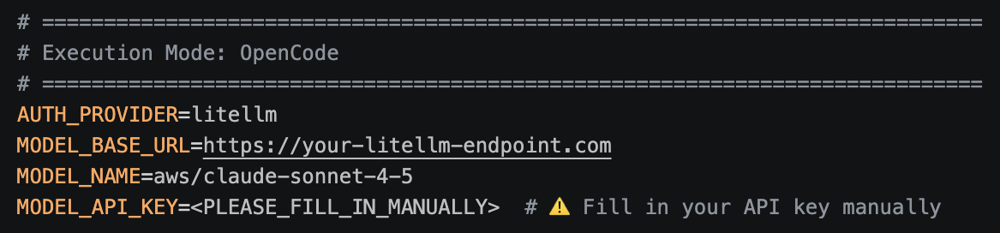
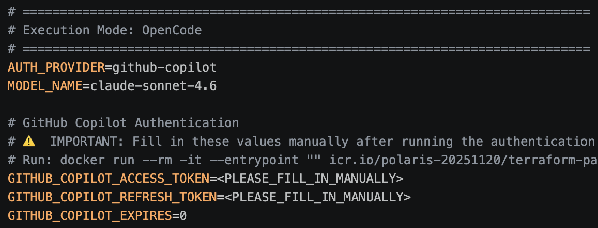

# Terraform Policy Agent - User Guide

## Table of Contents
1. [Overview](#overview)
2. [Prerequisites](#prerequisites)
3. [Agent Setup (Using tfpac-setup Skill)](#agent-setup-using-tfpac-setup-skill)
4. [Run (Using tfpac-run Skill)](#run-using-tfpac-run-skill)
5. [Understanding the Output](#understanding-the-output)
6. [Advanced Usage](#advanced-usage)
7. [Troubleshooting](#troubleshooting)

---

## Overview

The Terraform Policy Agent is a tool that automatically converts Sentinel policies to Terraform Policy (TFPolicy) format. This guide will walk you through the complete setup and usage process, by using a coding agent like OpenCode or GitHub Copilot CLI.

**What Terraform Policy Agent does:**
- Converts Sentinel policy code to TFPolicy format
- Generates test cases automatically
- Creates comprehensive documentation
- Validates the converted policies

**Workflow Overview:**
1. First, complete the [Prerequisites](#prerequisites) to prepare your environment
2. Next, use the [Agent Setup (Using tfpac-setup Skill)](#agent-setup-using-tfpac-setup-skill) to create the `.env` configuration file
3. Finally, use the [Run (Using tfpac-run Skill)](#run-using-tfpac-run-skill) to execute the Terraform Policy Agent

**Time to complete:** Approximately 30 minutes for first-time setup

---

## Prerequisites

**Before using the skills, you must complete the following steps manually:**
- Step 1: Clone the Repository
- Step 2: Prepare Coding Agent
- Step 3: Install Docker
- Step 4: Setup MCP Server
- Step 5: Prepare Required Binaries
- Step 6: Prepare Conversion Data
- Step 7: Copy Skills to Designated Location

### Step 1: Clone the Repository

Place the received `.tar.gz` file in your working directory, then run:

```bash
# Extract the package
tar zxvf terraform-policy-agent.tar.gz
cd terraform-policy-agent
```

**Expected result:**
```
$ ls
README.md                       pre-check.sh                    run_with_local_preparation.sh
USER_GUIDE.md                   pre_check.py                    sample-data
append_footer.py                run.sh                          skills
file_footer.hcl.template        run_pipeline.py                 stop.sh
github-copilot-access-setup.png run_with_external_repo.sh
```


### Step 2: Prepare Coding Agent

If you don't have a coding agent yet, install and set up one:

**Option A: OpenCode**

Download: https://opencode.ai/download

Launch:
```bash
opencode
```

**Option B: GitHub Copilot CLI**

Installation guide: https://docs.github.com/en/copilot/how-tos/copilot-cli/set-up-copilot-cli/install-copilot-cli

Launch:
```bash
copilot
```

### Step 3: Install Docker

If you don't have Docker yet, install it on your system:

**Option A: Docker Desktop**
- Download: https://www.docker.com/products/docker-desktop

**Option B: Rancher Desktop**
- Download: https://rancherdesktop.io/

**Verify installation:**
```bash
docker --version
```


### Step 4: Setup MCP Server
The agent requires a running MCP (Model Context Protocol) server for Terraform operations.

**Pull and run the MCP server:**

```bash
# Pull the MCP server image
docker pull docker.io/hashicorp/terraform-mcp-server:0.3.3

# Run the MCP server
docker run -d \
  --name terraform-mcp-server \
  -p 8500:8080 \
  -e TRANSPORT_MODE=streamable-http \
  -e TRANSPORT_HOST=0.0.0.0 \
  -e MCP_SESSION_MODE=stateless \
  --restart unless-stopped \
  docker.io/hashicorp/terraform-mcp-server:0.3.3
```

**Verify the server is running:**

```bash
docker run --rm -it --entrypoint "" \
  icr.io/polaris-20251120/terraform-pac-agent:0.0.26 \
  curl http://host.docker.internal:8500/health
```

**Expected response:**
```json
{"status":"ok","service":"terraform-mcp-server","transport":"streamable-http","endpoint":"/mcp"}
```

### Step 5: Prepare Required Binaries
Download the Linux binaries for Terraform and TFPolicy from your HashiCorp representative.

**Important:** The binaries must match your host architecture:
- **M1/M2 Mac:** Use `linux-arm64` binaries
- **Intel Mac/Linux:** Use `linux-amd64` binaries

Place the binaries in a known location, for example:
```bash
mkdir -p ~/terraform-binaries
# Copy your downloaded binaries here
```

**Note:** Remember this location, as you will need to specify these paths in [Step 13: Configure Terraform binary path](#step-13-configure-terraform-binary-path) and [Step 14: Configure TFPolicy binary path](#step-14-configure-tfpolicy-binary-path) during the [Agent Setup (Using tfpac-setup Skill)](#agent-setup-using-tfpac-setup-skill).

### Step 6: Prepare Conversion Data

Create the data directory structure:

```bash
cp -r sample-data data
```

This creates:
```
data/
├── input/
│   ├── policy_goal.txt
│   └── sentinels/
│       └── cloudfront-6.sentinel
└── output/  (will be created during execution)
```

### Step 7: Copy Skills to Designated Location

You need to copy the skills used by these two executions to their designated locations. Refer to the following instructions for OpenCode and GitHub Copilot CLI:

**For OpenCode:**

```bash
mkdir -p .opencode/skills
cp -R skills/tfpac-setup .opencode/skills/
cp -R skills/tfpac-run .opencode/skills/
```

**For GitHub Copilot CLI:**

```bash
mkdir -p .github/skills
cp -R skills/tfpac-setup .github/skills/
cp -R skills/tfpac-run .github/skills/
```


## Agent Setup (Using tfpac-setup Skill)

This section demonstrates the actual tfpac-setup Skill execution using OpenCode. Since this is an AI Agent, you may notice minor differences between the screenshots and your execution results, but the overall flow is expected to be the same.

### Step 8: Execute the /skills command

:skills.png)

Type `/skills` in your coding agent to view available skills.

### Step 9: Select the tfpac-setup skill

:tfpac-setup_selection.png)

Choose `tfpac-setup` from the list of available skills to start the interactive environment setup wizard.

### Step 10: Confirm tfpac-setup execution

:tfpac-setup_execution.png)

Press Enter in this state to execute the skill and begin the configuration wizard.

### Step 11: Docker image selection

docker_image_selection.png)

Here, select the recommended Docker image (1. Yes). If the Docker image is not available locally, the system will help you pull it. In that case, follow the instructions to pull the image.

### Step 12: Select execution mode

local_or_external.png)

Here, select "2. Local Mode" to use the `data/input` directory that you copied in [Step 6: Prepare Conversion Data](#step-6-prepare-conversion-data) of [Prerequisites](#prerequisites).

### Step 13: Configure Terraform binary path

terraform_binary.png)

Here, select "2. Type your own answer" and enter the path to your Terraform binary that you saved in [Step 5: Prepare Required Binaries](#step-5-prepare-required-binaries) of [Prerequisites](#prerequisites).

Example: `/Users/<your-username>/terraform-binaries/terraform`

**Note:** Replace `<your-username>` with your actual username.

### Step 14: Configure TFPolicy binary path

tfpolicy_binary.png)

Here, select "2. Type your own answer" and enter the path to your TFPolicy binary that you saved in [Step 5: Prepare Required Binaries](#step-5-prepare-required-binaries) of [Prerequisites](#prerequisites).

Example: `/Users/<your-username>/terraform-binaries/tfpolicy`

**Note:** Replace `<your-username>` with your actual username.

### Step 15: Select authentication provider

provider.png)

Choose your authentication method: LiteLLM (for enterprise endpoints) or GitHub Copilot. If you choose GitHub Copilot, the wizard will guide you through obtaining the required GitHub Copilot CLI credentials, as this setup is slightly more complex.

### Step 16: Pipeline configuration

pipeline_config.png)

Here, select the default (1. No). You can optionally customize pipeline settings such as data directories, input/output paths, and maximum workers for parallel processing.

### Step 17: Additional Docker settings

additinal_docker.png)

Here, select the default (1. No). You can optionally configure additional Docker settings like container prefix.

### Step 18: Timeout configuration

timeout.png)

Here, select the default (1. No). You can optionally adjust timeout values for each pipeline stage based on your policy complexity and processing requirements. Try with default values first - they should work for most cases.

### Step 19: Configuration validation

check.png)

Confirm that all required components (Docker, MCP server, binaries, and so on) are properly configured and accessible, before creating the `.env` file. If everything looks good, select "1. Yes" to proceed.

### Step 20: Preview generated .env file

preview_env.png)

Review the generated `.env` file content before saving. If there are no issues with the configuration, select "1. Yes" to save.


### Step 21: Setup completion and next steps

final_report.png)

Review the setup completion report showing configuration summary and next steps.

**Important:** After this setup, manually fill in secret values marked as `<PLEASE_FILL_IN_MANUALLY>` in the `.env` file:

- **For LiteLLM:** API key and endpoint URL
  
  

- **For GitHub Copilot:** Access token
  
  


## Run (Using tfpac-run Skill)

### Step 22: Execute the /skills command

:skills.png)

Type `/skills` in your coding agent to view available skills.

### Step 23: Select the tfpac-run skill

:skills_execution.png)

Choose `tfpac-run` from the list of available skills to start the policy conversion process.

### Step 24: Confirm tfpac-run execution

:tfpac-run.png)

Press Enter in this state to execute the skill.

### Step 25: Choose data source location

local_or_external.png)

Here, select "1. Convert from Sentinel - Manual Setup".

### Step 26: Output directory cleanup

output_cleanup.png)

If an output directory exists, you will be asked what to do with it. Choose to create a backup and cleanup (2. Backup and clean) or cleanup (3. Clean up) to avoid conflicts.

**Note:** On first execution, the output directory is empty, so this step will be skipped.

### Step 27: Pipeline execution starts

run.sh.png)

Here, select "1. Yes, execute". Then, `run.sh` script begins executing the policy conversion pipeline.

### Step 28: Select reporting time interval

time_selection.png)

Here, select "2. 60 seconds". This is the time interval for reporting the process status.

### Step 29: Interim progress report

interim_report.png)

The system provides interim reports at the interval you selected in the previous step, informing you of the current execution status, showing completed stages and progress.

### Step 30: Final conversion report

final_report.png)

Review the final report showing all converted policies, whether the conversion succeeded, test case evaluation results, and any issues encountered.


---

## Understanding the Output

After successful execution, your output directory will contain:

```
data/output/
├── goals/
│   ├── goal-001.txt
│   └── goal-002.txt
├── PolicyName/
│   ├── requirement.txt
│   ├── <policy_name>.policy.hcl
│   ├── <policy_name>.policytest.hcl
│   ├── main.tf
│   ├── gwt.json
│   └── report.md
├── summary.md
└── summary.json
```

### Key Output Files

| File | Description |
|------|-------------|
| `goals/goal-*.txt` | Extracted policy goals from input |
| `requirement.txt` | Detailed requirements for the policy |
| `*.policy.hcl` | Generated TFPolicy code |
| `*.policytest.hcl` | Generated test cases |
| `main.tf` | Terraform configuration for testing |
| `report.md` | Detailed conversion report |
| `summary.md` | Overall summary of all conversions |

---

### Reviewing Conversion Results

#### 1. Check the Summary Report

Open `data/output/summary.md` to get an overview of all conversions:

- **Conversion Statistics:** Success rate, total policies processed
- **Policy List:** Each policy's name, status, and key metrics
- **Quick Status:** See which policies succeeded or failed at a glance

#### 2. Review Individual Policy Reports

For detailed information about each policy, check the `report.md` file in each policy directory:

```bash
# Example: Review a specific policy's report
cat data/output/PolicyName/report.md
```

Each `report.md` contains:
- **Policy Overview:** What the policy checks
- **Conversion Details:** How Sentinel was translated to TFPolicy
- **Test Results:** Validation status
- **Implementation Notes:** Important considerations

---

## Advanced Usage

This guide uses coding agents (OpenCode or GitHub Copilot CLI), but you can also run the pipeline manually for more advanced control. See [README.md](README.md) for details.

## Troubleshooting

If you encounter issues not covered here:

1. **Check logs:** Review stage logs in `data/output/stage*.log`
2. **Verify configuration:** Double-check all settings in `.env`

---

**Document Version:** 2.0  
**Last Updated:** July 2026  