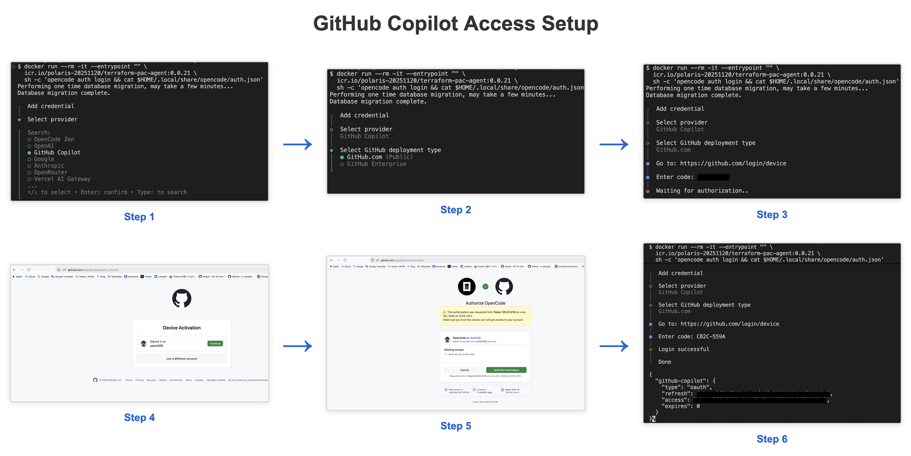

# terraform-pac-agent Quick Start Guide

## Getting Started

### 1. Setup Workspace

Prepare this folder.
Your workspace should contain:
```sh
$ ls
README.md                       pre-check.sh                    run_with_local_preparation.sh
USER_GUIDE.md                   pre_check.py                    sample-data
append_footer.py                run-crawler.sh                  crawler                         
run.sh                          skills                          file_footer.hcl.template
run_crawler.py                  stop.sh                         github-copilot-access-setup.png
run_pipeline.py                 photo                           run_with_external_repo.sh
```


### 2. Prerequisites

The agent runs in a container, so you'll need `docker` available on your system.

**Docker Image**:

Pull the pre-built Docker image from the registry:

```bash
# Login to IBM Cloud Container Registry
docker login icr.io -u iamapikey
# When prompted, enter your API key
docker pull icr.io/polaris-20251120/terraform-pac-agent:0.0.30-rc1.full.0.0.1
```

**Required Binaries**:

Download the following **Linux** binaries (used inside the container). The architecture must match your host machine:

- **Terraform CLI**: Currently in beta. Contact your HashiCorp representative to obtain the binary.
  - Required architecture: Linux ARM64 (for M1/M2 Mac) or Linux AMD64 (for Intel Mac/Linux)

- **TFPolicy CLI**: Currently in beta. Contact your HashiCorp representative to obtain the binary.
  - Required architecture: Linux ARM64 (for M1/M2 Mac) or Linux AMD64 (for Intel Mac/Linux)

**Required MCP Server**:

- **terraform-mcp-server**: HashiCorp's MCP server for Terraform operations
  - Must be running on `localhost:8500`
  - For detailed setup instructions, see: [terraform-mcp-server repository](https://github.com/hashicorp/terraform-mcp-server)
  
  **Recommended Setup:**
  
  Pull and run the MCP server:
  
  ```bash
  # Pull the Docker image
  docker pull docker.io/hashicorp/terraform-mcp-server:0.3.3
  
  # Run the MCP server
  docker run -d \
    --name terraform-mcp-server \
    -p 8500:8080 \
    -e TRANSPORT_MODE=streamable-http \
    -e TRANSPORT_HOST=0.0.0.0 \
    -e MCP_SESSION_MODE=stateless \
    --restart unless-stopped \
    docker.io/hashicorp/terraform-mcp-server:0.3.3
  ```
  
  **Verify connectivity:**
  
  Using pre-flight check:
  ```bash
  # Check MCP server only
  ./pre-check.sh mcp
  ```
  
  Or using curl from terraform-pac-agent container:
  ```bash
  docker run --rm -it --entrypoint "" \
    icr.io/polaris-20251120/terraform-pac-agent:0.0.30-rc1.full.0.0.1 \
    curl http://host.docker.internal:8500/health
  ```
  
  Expected response:
  ```json
  {"status":"ok","service":"terraform-mcp-server","transport":"streamable-http","endpoint":"/mcp"}
  ```

### 3. Configure Environment

Create `.env` file from the example:

```bash
cp .env.example .env
# Edit .env with your configuration
```

#### Authentication Configuration

Choose one of the following authentication providers:

**Option A: LiteLLM (Default)**

```bash
AUTH_PROVIDER=litellm
MODEL_BASE_URL=https://your-litellm-endpoint.com
MODEL_NAME=aws/claude-sonnet-4-5
MODEL_API_KEY=sk-your-litellm-api-key
```

- `AUTH_PROVIDER`: Set to `litellm`
- `MODEL_BASE_URL`: Your LiteLLM endpoint URL
- `MODEL_NAME`: Model identifier (e.g., `aws/claude-sonnet-4-5`)
- `MODEL_API_KEY`: Your LiteLLM API key

**Option B: GitHub Copilot**

```bash
AUTH_PROVIDER=github-copilot
MODEL_NAME=claude-sonnet-4.6
GITHUB_COPILOT_ACCESS_TOKEN=gho_your_access_token
GITHUB_COPILOT_REFRESH_TOKEN=gho_your_refresh_token  # Optional, defaults to access token
GITHUB_COPILOT_EXPIRES=0  # Optional, defaults to 0
```

- `AUTH_PROVIDER`: Set to `github-copilot`
- `MODEL_NAME`: Select a GitHub Copilot supported model (e.g., `claude-sonnet-4.6`, `gpt-5.2`)
  - Supported models (verified as of June 2026): `claude-sonnet-4.6`, `gpt-5.2`
  - Note: `claude-sonnet-4.5` is NOT supported by GitHub Copilot (verified as of June 2026)
  - You can switch between supported models without changing the access token
- `GITHUB_COPILOT_ACCESS_TOKEN`: Your GitHub Copilot access token
- `GITHUB_COPILOT_REFRESH_TOKEN`: (Optional) Refresh token, defaults to access token if not set
- `GITHUB_COPILOT_EXPIRES`: (Optional) Token expiration timestamp, defaults to 0

**How to get GitHub Copilot tokens:**

**Recommended: Using Docker container (no local installation required)**

Run the following command to obtain tokens in an isolated container environment:

```bash
docker run --rm -it --entrypoint "" \
  icr.io/polaris-20251120/terraform-pac-agent:0.0.30-rc1.full.0.0.1 \
  sh -c 'opencode auth login && cat $HOME/.local/share/opencode/auth.json'
```

This will:
1. Launch the OpenCode authentication flow in an isolated container
2. Prompt you to select GitHub Copilot as the provider
3. Choose deployment type (usually GitHub.com)
4. Display a login URL (e.g., `https://github.com/login/device`) and code
5. After you authorize in your browser, display the tokens from `auth.json`



**Alternative: Using local OpenCode installation**

If you prefer to install OpenCode locally, you can run:

```bash
opencode auth login
cat ~/.local/share/opencode/auth.json
```

Note: This requires OpenCode to be installed on your system. The container method is recommended as it keeps your system clean and isolated.

#### Complete `.env` Example

```bash
# Authentication (choose one option above)
AUTH_PROVIDER=litellm
MODEL_BASE_URL=https://your-litellm-endpoint.com
MODEL_NAME=aws/claude-sonnet-4-5
MODEL_API_KEY=sk-your-litellm-api-key

# Binaries (required - must match container architecture)
# M1/M2 Mac: use linux-arm64 binaries
# Intel Mac/Linux: use linux-amd64 binaries
TERRAFORM_BINARY_PATH=/path/to/terraform
TFPOLICY_BINARY_PATH=/path/to/tfpolicy

# External Repository Path (Primary use case)
# Set this to convert Sentinel policies from an external repository
EXTERNAL_REPO_DIR=/path/to/your/sentinel-repository

# Data directories (used when EXTERNAL_REPO_DIR is not set)
DATA_DIR=./data
INPUT_DIR=input
INPUT_FILE=policy_goal.txt
OUTPUT_DIR=output

# Execution
MAX_WORKERS=5
IMAGE_NAME=icr.io/polaris-20251120/terraform-pac-agent
IMAGE_TAG=0.0.30-rc1.full.0.0.1

# Stage 0: Extraction timeout
STAGE0_TIMEOUT=600  # Optional, defaults to 600 (10 minutes)

# Stage 1: Requirement Generation timeout (per goal)
STAGE1_TIMEOUT=300  # Optional, defaults to 300 (5 minutes)

# Stage 2: Policy Generation timeout (per policy)
STAGE2_TIMEOUT=900  # Optional, defaults to 900 (15 minutes)

# Stage 3: Summary Generation timeout
STAGE3_TIMEOUT_BASE=180  # Optional, defaults to 180 (3 minutes base)
STAGE3_TIMEOUT_PER_POLICY=60  # Optional, defaults to 60 (1 minute per policy)

# If using the crawler
# CRAWLER_TIMEOUT=3600 # Optional, defaults to 3600 (60 minutes)

# If you want to generate policies based on control IDs or natural language input
# You have to set policy spec database path
# POLICY_DB=database/policy_spec_db.jsonl  # Optional, defaults to database/policy_spec_db.jsonl (if you run the crawler, the database will be created at this path)
```

## Usage

### Pre-flight Check (Recommended)

Before running the pipeline, verify all prerequisites are met:

```bash
# Check all prerequisites
./pre-check.sh

# Or check specific components
./pre-check.sh docker    # Docker daemon only
./pre-check.sh mcp       # MCP server only
./pre-check.sh binaries  # terraform/tfpolicy binaries only
./pre-check.sh env       # Environment variables only

# JSON output for automation
./pre-check.sh --json
./pre-check.sh mcp --json
```

Note: `pre-check.sh` automatically detects and uses the available Python interpreter (`python3` or `python`).

The pre-flight check will verify:
- 🟢 **docker**: Docker daemon is running
- 🟢 **env**: Environment variables are properly configured
- 🟢 **binaries**: terraform and tfpolicy binaries are available and executable
- 🟢 **input**: Input files exist
- 🟢 **image**: Docker image is available
- 🟢 **mcp**: MCP server is accessible at localhost:8500

If any issues are found, the tool will provide clear error messages with 🔴 status and suggestions for fixing them.

### Generation

**Step 1: Prepare Policy Spec Database**

When generating policies from control IDs or natural language, the pipeline requires a policy specification database.

**If you already have a database**, set its path in `.env`:

```bash
POLICY_DB=database/policy_spec_db.jsonl
```

Skip to **Step 2: Create Input File**

**If you do not have a database yet**, build one with the following steps:

**Step 1.1:** Create `crawler/crawler_goal.txt` and specify the data source:

```
https://docs.aws.amazon.com/securityhub/latest/userguide/cloudfront-controls.html
```

**Step 1.2:** Crawl the data source to generate pending changes:

```bash
./run-crawler.sh add
```

**Step 1.3:** Review the pending changes in `crawler/report/delta/{timestamp}.jsonl`. If the content looks correct, set that file as the input in `crawler/crawler_goal.txt`:

```
report/delta/{timestamp}.jsonl
```

**Step 1.4:** Apply the changes to create the database:

```bash
./run-crawler.sh apply
```

This produces `database/policy_spec_db.jsonl`.

> For full crawler documentation, see [`crawler/README.md`](crawler/README.md).

**Step 2: Create Input File**

Create `data/input/policy_goal.txt` with your target policy information:

**Option A: Control IDs**
````
Generate TF Policy for
SecurityHub: CloudFront.6
````

**Option B: Natural Language**
````
Generate TF Policy for
Ensure that EC2 instances have detailed monitoring enabled.
````

**Step 3: Run the pipeline**

```bash
./run.sh local
```

**Output:**

Output files are generated in the directory specified by `OUTPUT_DIR` in your `.env` file (default: `data/output`):

```sh
$ ls ./data/output
CloudFront_Associated_WAF   goals                   summary.json
stage0_extraction.log       stage3_summary.log      summary.md
```

**Important:** The `OUTPUT_DIR` must be empty before running the full pipeline to prevent accidental overwrites. If you need to run multiple conversions, set a different `OUTPUT_DIR` in `.env` for each run (e.g., `OUTPUT_DIR=output-v2`, `OUTPUT_DIR=results-20260603`).

## Using the Skill with a Coding Agent

You can also use the packaged skill with a coding agent instead of running commands manually.

### 1. Place the skill in your agent's skill directory

Place the skill in the appropriate directory for your coding agent:

**For OpenCode:**
```bash
mkdir -p .opencode/skills
cp -R skills/tfpac-setup .opencode/skills/
```

**For GitHub Copilot CLI:**
```bash
mkdir -p .github/skills
cp -R skills/tfpac-setup .github/skills/
```

### 2. Start your coding agent with your preferred provider and model

Configure your coding agent (OpenCode or GitHub Copilot CLI) to use your LLM provider and model as usual.

### 3. Open the skills menu and select the skill

In your coding agent:

- type `/skills`
- select `tfpac-setup`

The skill will ask which workflow you want to use and guide you accordingly:

- **Generation** — Generate TF policies from an existing policy spec database
- **Generation with Crawler** — Build a policy spec database from URLs/files using the crawler, then generate TF policies
- **Conversion** — Convert existing Sentinel policies to TF policies (external repository or manual preparation)

The skill then guides the workflow in this order:

1. **Input setup assistance**
   - Help create `.env` file from `.env.example`
   - Assist with preparing policy spec database via crawler *(if Generation with Crawler workflow)*, or pointing to an existing policy spec database *(if Generation workflow)*
   - Guide creation of `data/input/policy_goal.txt`
2. **Prerequisite check**
   - Verify Docker image availability
   - Check required binaries (terraform, tfpolicy)
   - Validate MCP server connection
3. **Crawler run** *(if Generation with Crawler workflow)*
   - Show how to execute the crawler with `./run-crawler.sh`
4. **Pipeline run**
   - Show how to execute the pipeline with `./run.sh`

### Optional: `tfpac-run` Skill

You can also use the `tfpac-run` skill to have a coding agent guide you through steps 3 and 4 (crawler run and pipeline run).

**For OpenCode:**
```bash
mkdir -p .opencode/skills
cp -R skills/tfpac-run .opencode/skills/
```

**For GitHub Copilot CLI:**
```bash
mkdir -p .github/skills
cp -R skills/tfpac-run .github/skills/
```

Then type `/skills` and select `tfpac-run` — the coding agent will guide you through executing the crawler (if needed) and the pipeline.

## Pipeline Stages

The pipeline (`./run.sh`) runs 4 stages automatically:

- **Stage 0**: Extract policy goals → `data/output/goals/`
- **Stage 1**: Generate requirements → `data/output/PolicyName/requirement.txt`
- **Stage 2**: Generate policies and tests → `data/output/PolicyName/*.hcl`, `*.tf`
- **Stage 3**: Create summary → `data/output/summary.md`

## Output Structure

```
data/
├── input/
│   └── policy_goal.txt
└── output/
    ├── goals/
    │   ├── goal-001.txt
    │   └── goal-002.txt
    ├── PolicyName/
    │   ├── requirement.txt
    │   ├── <policy_name>.policy.hcl
    │   ├── <policy_name>.policytest.hcl
    │   ├── main.tf
    │   ├── gwt.json
    │   └── report.md
    ├── summary.md
    └── summary.json
```

## Advanced Usage

### Run Specific Steps (Generation and Local Mode)

```bash
./run.sh local --step 0
./run.sh local --step 1 --goal-file goal-001.txt
./run.sh local --step 2 --policy-dir CloudFront_Associated_WAF
./run.sh local --step 3
```

### Run Specific Phases (External Mode)

```bash
./run.sh external --phase preprocess    # Extract only
./run.sh external --phase generate      # Generate only
./run.sh external --phase postprocess   # Deploy only
```

### Help

```bash
./run.sh --help
./run.sh local --help
./run.sh external --help
```

### Pipeline Fails
- Check `data/input/policy_goal.txt` exists and is properly formatted
- Verify binary paths in `.env` are correct
- Check logs in `data/output/stage*.log`