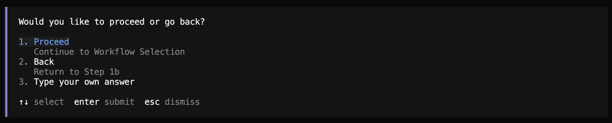

# Terraform Policy Agent - User Guide

## Table of Contents
1. [Overview](#overview)
2. [Prerequisites](#prerequisites)
3. [Agent Setup (Using tfpac-setup Skill)](#agent-setup-using-tfpac-setup-skill)
4. [Run (Using tfpac-run Skill)](#run-using-tfpac-run-skill)
5. [Understanding the Output](#understanding-the-output)
6. [Advanced Usage](#advanced-usage)
7. [Troubleshooting](#troubleshooting)

---

## Overview

The Terraform Policy Agent is a tool that automatically converts Sentinel policies to Terraform Policy (TFPolicy) format. This guide will walk you through the complete setup and usage process, by using a coding agent like OpenCode or GitHub Copilot CLI.

**What Terraform Policy Agent does:**
- Converts Sentinel policy code to TFPolicy format
- Generates test cases automatically
- Creates comprehensive documentation
- Validates the converted policies

**Workflow Overview:**
1. First, complete the [Prerequisites](#prerequisites) to prepare your environment
2. Next, use the [Agent Setup (Using tfpac-setup Skill)](#agent-setup-using-tfpac-setup-skill) to create the `.env` configuration file
3. Finally, use the [Run (Using tfpac-run Skill)](#run-using-tfpac-run-skill) to execute the Terraform Policy Agent

**Time to complete:** Approximately 60–120 minutes for first-time setup

---

## Prerequisites

> ⚠️ **All commands in this guide must be run in a terminal — not VS Code's Source Control panel.**
> Open a terminal in VS Code with **Terminal → New Terminal**, or use your system terminal app.
> Using the Source Control panel for git commands or any shell commands will cause unexpected behaviour.

**Before using the skills, you must complete the following steps manually:**
- Step 1: Extract the Package
- Step 2: Prepare Python
- Step 3: Prepare Coding Agent
- Step 4: Install Docker
- Step 5: Setup MCP Server
- Step 6: Prepare Conversion Data
- Step 7: Copy Skills to Designated Location

### Step 1: Extract the Package

> **NOTE:** This package is distributed from the `main` branch of the repository.

Place the received `.tar.gz` file in your working directory. **Recommended location: your home directory (`~/`). Avoid paths with spaces** (e.g., `~/Desktop/My Projects/`) as they can cause shell script failures.

Run each command separately — paste one line, press Enter, wait for it to complete, then proceed to the next:

Extract the package:
```bash
tar zxvf terraform-policy-agent.tar.gz
```

Move into the directory:
```bash
cd terraform-policy-agent
```

**Expected result:**
```
$ ls
README.md                       pre-check.sh                    run_with_local_preparation.sh
USER_GUIDE.md                   pre_check.py                    sample-data
append_footer.py                run.sh                          skills
file_footer.hcl.template        run_pipeline.py                 stop.sh
github-copilot-access-setup.png run_with_external_repo.sh
```


### Step 2: Prepare Python

**Python**:

Python 3.10 or later is required.

```bash
python3 --version  # Must be 3.10 or later
```

If Python is missing or outdated, install or update it.


### Step 3: Prepare Coding Agent

If you don't have a coding agent yet, install and set up one:

**Option A: OpenCode**

Download: https://opencode.ai/download

Or install via Homebrew (Mac):
```bash
brew install opencode
```

> **Note:** Homebrew will install Node.js and other dependencies (~150 MB total). Allow 2–3 minutes. If your environment has a locked Node.js version, be aware of potential conflicts. If `opencode` is not found after install, open a new terminal window and try again.

Launch:
```bash
opencode
```

**Option B: GitHub Copilot CLI**

Installation guide: https://docs.github.com/en/copilot/how-tos/copilot-cli/set-up-copilot-cli/install-copilot-cli

Launch:
```bash
copilot
```

> **Note:** If you are using VS Code, the Copilot features you may see inside VS Code (inline completions, chat panel) are **not** the same as the GitHub Copilot CLI above — they are separate tools.

> **Note:** If you see a blue **"Finish Setup"** button in the right panel of your coding agent, this configures the AI assistant for the project — it is not part of the product setup steps in this guide. You can ignore it until after completing all prerequisites.

### Step 4: Install Docker

If you don't have Docker yet, install it on your system:

**Option A: Docker Desktop**
- Download: https://www.docker.com/products/docker-desktop
- Or install via Homebrew (Mac): `brew install --cask docker`

**Option B: Rancher Desktop**
- Download: https://rancherdesktop.io/

**Verify installation:**
```bash
docker --version
```

**⚠️ Important:** If Docker Desktop prompts you to sign in with a work email on first launch, click **Skip** — sign-in is not required for any operation in this tool. If you see an error saying "Contact your company administrator", ignore it and click Skip — this is not a blocker.

**⚠️ Folder Access:** On first pipeline run, Docker may request permission to access your working directory (e.g., Documents, Desktop). Grant access in **System Settings → Privacy & Security → Files and Folders**. If access is denied, the pipeline may stop silently without any error message.


### Step 5: Setup MCP Server

The MCP (Model Context Protocol) server provides the Terraform registry lookup and resource documentation that the agent uses during policy generation. Without it, the pipeline cannot resolve Terraform resource schemas.

The agent requires a running MCP server for Terraform operations.

**Pull and run the MCP server:**

Pull the MCP server image:
```bash
docker pull docker.io/hashicorp/terraform-mcp-server:1.1.0
```

> **Note:** Docker may suggest `docker scout quickview` after the pull — you can safely ignore this.

Run the MCP server:
```bash
docker run -d \
  --name terraform-mcp-server \
  -p 8500:8080 \
  -e TRANSPORT_MODE=streamable-http \
  -e TRANSPORT_HOST=0.0.0.0 \
  -e MCP_SESSION_MODE=stateless \
  --restart unless-stopped \
  docker.io/hashicorp/terraform-mcp-server:1.1.0
```

**⚠️ Required: Verify the server is running before proceeding:**

```bash
docker run --rm -it --entrypoint "" \
  --add-host=host.docker.internal:host-gateway \
  icr.io/terraform-policy-agent-2026/terraform-pac-agent:0.0.30-rc1-uxfix \
  curl http://host.docker.internal:8500/health
```

**Expected response:**
```json
{"status":"ok","service":"terraform-mcp-server","transport":"streamable-http","endpoint":"/mcp"}
```

> **Note:** If using VS Code or a similar editor, the status bar may show an MCP connection count (for example, `2/2 MCP`). This is unrelated to this project and can be ignored.

### Step 6: Prepare Conversion Data

Create the data directory structure:

```bash
cp -r sample-data data
```

Verify the directory was created correctly:
```bash
ls -R data/
```

This shows:
```
data/
├── input/
│   ├── policy_goal.txt
│   └── sentinels/
│       └── cloudfront-6.sentinel
└── output/  (will be created during execution)
```

### Step 7: Copy Skills to Designated Location

You need to copy the skills used by these two executions to their designated locations. Refer to the following instructions for OpenCode and GitHub Copilot CLI:

**For OpenCode:**

```bash
mkdir -p .opencode/skills && \
cp -R skills/tfpac-setup .opencode/skills/ && \
cp -R skills/tfpac-run .opencode/skills/ && \
ls .opencode/skills/
```

Expected output:
```
tfpac-run  tfpac-setup
```

**For GitHub Copilot CLI:**

```bash
mkdir -p .github/skills && \
cp -R skills/tfpac-setup .github/skills/ && \
cp -R skills/tfpac-run .github/skills/ && \
ls .github/skills/
```

Expected output:
```
tfpac-run  tfpac-setup
```


## Agent Setup (Using tfpac-setup Skill)

This section demonstrates the actual tfpac-setup Skill execution using OpenCode. Since this is an AI Agent, you may notice minor differences between the screenshots and your execution results, but the overall flow is expected to be the same.

> **NOTE 1:** After each step, you will be prompted with **Proceed** or **Back** as shown in the screenshots below. Select **Back** if you want to return and make corrections. In most cases where no correction is needed, select **Proceed** to continue.



> **NOTE 2:** Intermediate results are saved to a file called `.env.tmp` as you progress through each step. At the end, the actual `.env` file used for execution is generated from it.

### Step 8: Execute the /skills command


:skills.png)

Type `/skills` in your coding agent to view available skills.

**Note:** If OpenCode displays a tip such as "Run `/connect` to add an AI provider", ignore it and proceed with `/skills`. AI provider configuration related to this project is handled by the tfpac-setup skill.

> **OpenCode runs inside your terminal (e.g., inside the VS Code integrated terminal):** OpenCode launches as a full-screen text interface (TUI). The terminal tab will show `opencode` and the interface fills the panel completely. This is normal. To exit OpenCode and return to the regular terminal, press **Ctrl+C** or type `/exit`.

> **NOTE:** After this step, you can go back to a previous step if needed. If everything looks correct, select **proceed** to continue.

### Step 9: Select the tfpac-setup skill

:tfpac-setup_selection.png)

Choose `tfpac-setup` from the list of available skills to start the interactive environment setup wizard.

> **NOTE:** `customize-opencode` may appear at the top of the skills list — ignore it. It is unrelated to this product.

> **NOTE:** After this step, you can go back to a previous step if needed. If everything looks correct, select **proceed** to continue.

### Step 10: Confirm tfpac-setup execution

:tfpac-setup_execution.png)

Press Enter in this state to execute the skill and begin the configuration wizard.

> **NOTE:** After this step, you can go back to a previous step if needed. If everything looks correct, select **proceed** to continue.

### Step 11: Docker image selection

docker_image_selection.png)

Here, select the recommended Docker image (1. Yes). If the Docker image is not available locally, the system will help you pull it. In that case, follow the instructions to pull the image — an IBM Cloud Container Registry API key (`iamapikey`) is required to run `docker login icr.io -u iamapikey`.

> **Note:** The size of this image is large. Allow 2–5 minutes on broadband. If the pull is interrupted, re-running the command will resume automatically.

> **NOTE:** After this step, you can go back to a previous step if needed. If everything looks correct, select **proceed** to continue.

### Step 12: Select execution mode

local_or_external.png)

Here, select "2. Local Mode" to use the `data/input` directory that you copied in [Step 6: Prepare Conversion Data](#step-6-prepare-conversion-data) of [Prerequisites](#prerequisites).

> **NOTE:** After this step, you can go back to a previous step if needed. If everything looks correct, select **proceed** to continue.

### Step 13: Configure Terraform binary path

terraform_binary.png)

Select **2. No, download it** to have the wizard automatically download and configure the correct Terraform binary for your architecture.

> **NOTE:** After this step, you can go back to a previous step if needed. If everything looks correct, select **proceed** to continue.

### Step 14: Configure TFPolicy binary path

tfpolicy_binary.png)

Select **2. No, download it** to have the wizard automatically download and configure the correct TFPolicy binary for your architecture.

> **NOTE:** After this step, you can go back to a previous step if needed. If everything looks correct, select **proceed** to continue.

### Step 15: Select authentication provider

provider.png)

Choose your authentication method: LiteLLM (for enterprise endpoints), Amazon Bedrock (Bearer Token), or GitHub Copilot. If you choose GitHub Copilot, the wizard will guide you through obtaining the required GitHub Copilot CLI credentials, as this setup is slightly more complex.

**Recommended model:** `claude-sonnet-5` — best balance of quality and cost for policy conversion.

> **NOTE:** After this step, you can go back to a previous step if needed. If everything looks correct, select **proceed** to continue.

### Step 16: Pipeline configuration

pipeline_config.png)

Here, select the default (1. No). You can optionally customize pipeline settings such as data directories, input/output paths, and maximum workers for parallel processing.

> **NOTE:** After this step, you can go back to a previous step if needed. If everything looks correct, select **proceed** to continue.

### Step 17: Additional Docker settings

additinal_docker.png)

Here, select the default (1. No). You can optionally configure additional Docker settings like container prefix.

> **NOTE:** After this step, you can go back to a previous step if needed. If everything looks correct, select **proceed** to continue.

### Step 18: Timeout configuration

timeout.png)

Here, select the default (1. No). You can optionally adjust timeout values for each pipeline stage based on your policy complexity and processing requirements. Try with default values first - they should work for most cases.

> **NOTE:** After this step, you can go back to a previous step if needed. If everything looks correct, select **proceed** to continue.

### Step 19: Configuration validation

check.png)

Confirm that all required components (Docker, MCP server, binaries, and so on) are properly configured and accessible, before creating the `.env` file. If everything looks good, select "1. Yes" to proceed.

> **NOTE:** After this step, you can go back to a previous step if needed. If everything looks correct, select **proceed** to continue.

### Step 20: Preview generated .env file

preview_env.png)

Review the generated `.env` file content before saving. If there are no issues with the configuration, select "1. Yes" to save.

> **NOTE:** After this step, you can go back to a previous step if needed. If everything looks correct, select **proceed** to continue.


### Step 21: Setup completion and next steps

final_report.png)

Review the setup completion report showing configuration summary and next steps.

**Important:** After this setup, manually fill in secret values marked as `<PLEASE_FILL_IN_MANUALLY>` in the `.env` file:

- **For LiteLLM:** API key and endpoint URL
  
  

- **For Amazon Bedrock:** Bearer Token (Base64 encoded API key)

  Set `MODEL_API_KEY` to your Bedrock Bearer Token in the `.env` file.

- **For GitHub Copilot:** Access token

  Run this command to authenticate and retrieve your GitHub Copilot tokens:

  ```bash
  docker run --rm -it --entrypoint "" \
    icr.io/terraform-policy-agent-2026/terraform-pac-agent:0.0.30-rc1-uxfix \
    sh -c 'opencode auth login && cat $HOME/.local/share/opencode/auth.json'
  ```

  **Follow the prompts:**
  1. Select "GitHub Copilot" as provider
  2. Choose deployment type (usually "GitHub.com")
  3. Open the displayed URL in your browser
  4. Enter the device code shown
  5. Authorize the application

  If you have already authenticated on the host machine, the token is stored in the following file by default:

  ```bash
  cat ~/.local/share/opencode/auth.json
  ```
  
  


## Run (Using tfpac-run Skill)

### Step 22: Execute the /skills command

:skills.png)

Type `/skills` in your coding agent to view available skills.

### Step 23: Select the tfpac-run skill

:skills_execution.png)

Choose `tfpac-run` from the list of available skills to start the policy conversion process.

> **NOTE:** You can target a specific policy instead of converting all policies at once by passing a natural language identifier (such as a policy name or ID) with the `--policy` flag: `/tfpac-run --policy <identifier>`. This is useful for reducing compute cost when testing a single policy.

### Step 24: Confirm tfpac-run execution

:tfpac-run.png)

Press Enter in this state to execute the skill.

### Step 25: Choose data source location

local_or_external.png)

Here, select "1. Convert from Sentinel - Manual Setup".

### Step 26: Output directory cleanup

output_cleanup.png)

If an output directory exists, you will be asked what to do with it. Choose to create a backup and cleanup (2. Backup and clean) or cleanup (3. Clean up) to avoid conflicts.

**Note:** On first execution, the output directory is empty, so this step will be skipped.

### Step 27: Pipeline execution starts

run.sh.png)

Here, select "1. Yes, execute". Then, `run.sh` script begins executing the policy conversion pipeline.

### Step 28: Select reporting time interval

time_selection.png)

Here, select "2. 60 seconds". This is the time interval for reporting the process status.

### Step 29: Interim progress report

interim_report.png)

The system provides interim reports at the interval you selected in the previous step, informing you of the current execution status, showing completed stages and progress.

### Step 30: Final conversion report

final_report.png)

Review the final report showing all converted policies, whether the conversion succeeded, test case evaluation results, and any issues encountered.


---

## Understanding the Output

After successful execution, your output directory will contain:

```
data/output/
├── goals/
│   ├── goal-001.txt
│   └── goal-002.txt
├── PolicyName/
│   ├── requirement.txt
│   ├── <policy_name>.policy.hcl
│   ├── <policy_name>.policytest.hcl
│   ├── main.tf
│   ├── gwt.json
│   └── report.md
├── summary.md
└── summary.json
```

### Key Output Files

| File | Description |
|------|-------------|
| `goals/goal-*.txt` | Extracted policy goals from input |
| `requirement.txt` | Detailed requirements for the policy |
| `*.policy.hcl` | Generated TFPolicy code |
| `*.policytest.hcl` | Generated test cases |
| `main.tf` | Terraform configuration for testing |
| `report.md` | Detailed conversion report |
| `summary.md` | Overall summary of all conversions |

---

### Reviewing Conversion Results

#### 1. Check the Summary Report

Open `data/output/summary.md` to get an overview of all conversions:

- **Conversion Statistics:** Success rate, total policies processed
- **Policy List:** Each policy's name, status, and key metrics
- **Quick Status:** See which policies succeeded or failed at a glance

#### 2. Review Individual Policy Reports

For detailed information about each policy, check the `report.md` file in each policy directory:

```bash
# Example: Review a specific policy's report
cat data/output/PolicyName/report.md
```

Each `report.md` contains:
- **Policy Overview:** What the policy checks
- **Conversion Details:** How Sentinel was translated to TFPolicy
- **Test Results:** Validation status
- **Implementation Notes:** Important considerations

---

## Advanced Usage

This guide uses coding agents (OpenCode or GitHub Copilot CLI), but you can also run the pipeline manually for more advanced control. See [README.md](README.md) for details.

## Resuming a Session

If you take a break and return later, run the following to restore the required services:

```bash
# Check running containers (look for terraform-mcp-server)
docker ps -a
```

- If `terraform-mcp-server` shows **Up** — already running, nothing to do.
- If it shows **Exited** — restart it:
  ```bash
  docker start terraform-mcp-server
  ```

```bash
# Confirm the MCP server image is present
docker image ls hashicorp/terraform-mcp-server:1.1.0
```

If the image is missing, re-run the `docker pull` command from Step 5.

If you interrupted `tfpac-setup` or `tfpac-run` mid-way, simply run the skill again from the beginning.

---

## Troubleshooting

If you encounter issues not covered here:

1. **Check logs:** Review stage logs in `data/output/stage*.log`
2. **Verify configuration:** Double-check all settings in `.env`
3. **See [TROUBLESHOOTING.md](TROUBLESHOOTING.md)** for known error patterns and fixes.

---

**Document Version:** 2.0
**Applies to IMAGE_VERSION:** 0.0.30-rc1-uxfix
**Last Updated:** July 2026